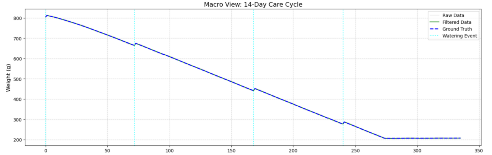
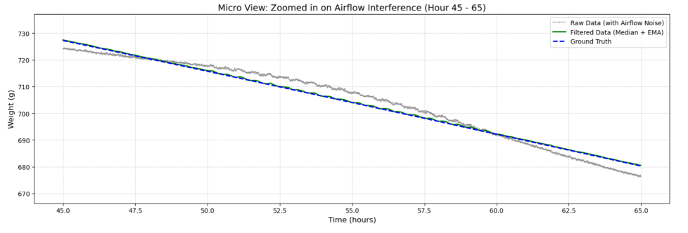

# SproutSync - IoT Edge Signal Processing Simulation

## 📌 Overview
This repository contains the edge computing simulation for **SproutSync**, a precision care system designed for high-value mounted Staghorn Ferns. The system utilizes **ESP32**, **HX711 load cells**, and **DHT11 temperature sensors** to accurately track plant weight and predict dehydration risk.

## 🚨 Problem: Real-World Sensor Noise
Raw weight data from HX711 load cells is heavily contaminated by:
1. **Thermal Drift:** Daily temperature fluctuations cause strain gauge expansion/contraction, leading to significant baseline drift.
2. **Airflow Interference:** AC drafts or wind introduce high-frequency sinusoidal jitter and random spikes.
3. **Sensor Baseline Noise:** HX711 input noise is approximately **50 nV(rms)** at 10 SPS, and practical jitter for a 5 kg load cell is often **100–200 mg** at 10 Hz sampling.

Without proper filtering, these interferences cause severe false alerts and inaccurate dehydration detection for the end-user.

## 🛠️ Solution: 3-Stage Edge Filtering Pipeline
We implement a lightweight, microcontroller-friendly filtering pipeline:
1. **Thermal Compensation:** Using DHT11 ambient temperature data to subtract the thermal drift dynamically.
2. **Median Filter (k=3):** Removes airflow-induced spikes without flattening the actual watering step response.
3. **EMA (α=0.15):** Smoothes the remaining Gaussian baseline noise with **O(1)** memory and computation complexity, ensuring real-time performance on the ESP32.

## 📊 Results
- **Raw RMSE:** ~2.83 g (under thermal drift + airflow interference)
- **Optimized RMSE:** ~0.33 g
- **Noise Reduction:** **~88%** (Stable across multiple randomized simulations)

The compensated EMA curve perfectly tracks the true dehydration trend while preserving real watering events, ensuring the dehydration detection error remains **< 12 hours**.

### Macro View: 14-Day Care Cycle


### Micro View: Zoomed-in on Airflow Interference


## 📚 References & Data Sources
- **HX711 Noise Floor:** Datasheet specifies input noise of **50 nV(rms)** at 10 SPS (Gain=128).
  - *HX711 Datasheet (AVIA Semiconductor, V2.0).* [Link](https://www.alldatasheet.co.nz/html-pdf/1132222/AVIA/HX711/341/3/HX711.html)
- **HX711 Practical Jitter:** Community measurements report **100–200 mg** jitter for 5 kg load cells at 10 Hz; a median filter followed by EMA is recommended for better stability.
  - *Arduino Forum Discussion.* [Link](https://forum.arduino.cc/t/noise-reduction-and-adc-precision-tips-for-stm32l031k6-hx711-weighing-system/1453873/9)
- **EMA for Sensor Denoising:** EMA filter applied to IMU vibration noise removal; the performance depends on the chosen α parameter.
  - *Noise Removal in The IMU Sensor Using Exponential Moving Average with Parameter Selection in Remotely Operated Vehicle (ROV)*, IEEE Xplore, 2022. [Link](https://ieeexplore.ieee.org/document/10136259)
- **Load Cell Thermal Compensation:** Temperature gradients cause unstable compensation; proper placement of compensation resistors and thermal analysis are essential.
  - *Temperature field analysis and compensation improvement of load cell*, Scientific Reports (Nature), 2024. [Link](https://www.nature.com/articles/s41598-024-76688-0)

## 📦 Requirements  
To run the simulation locally, ensure you have Python 3.8+ installed, then run:
```bash```
pip install numpy matplotlib scipy

## 🚀 Usage
You can run the simulation directly via the Jupyter Notebook (SproutSync_Simulation.ipynb) or the Python script.

## 📄 License
This project is developed for academic purposes as part of the XJTLU Entrepreneur College module. Please contact the authors for commercial use.

## 🤖 AI Usage Statement
In accordance with academic integrity guidelines, we declare that AI tools (Large Language Models) were used to assist in the development of this repository. Specifically, AI was utilized for:

Generating the initial Python framework and boilerplate for the simulation.

Assisting with the translation and structural formatting of this README.md document.

Suggesting parameter values for the EMA and Median filters based on general physical principles.

Human Contribution: The core algorithm logic, the 3-stage filtering pipeline design, the physical modeling of thermal drift and airflow interference, the parameter tuning (e.g., α=0.15), and the final validation of results were entirely designed, reviewed, and implemented by the SproutSync team. We retain full ownership and responsibility for all code and conclusions presented here.
